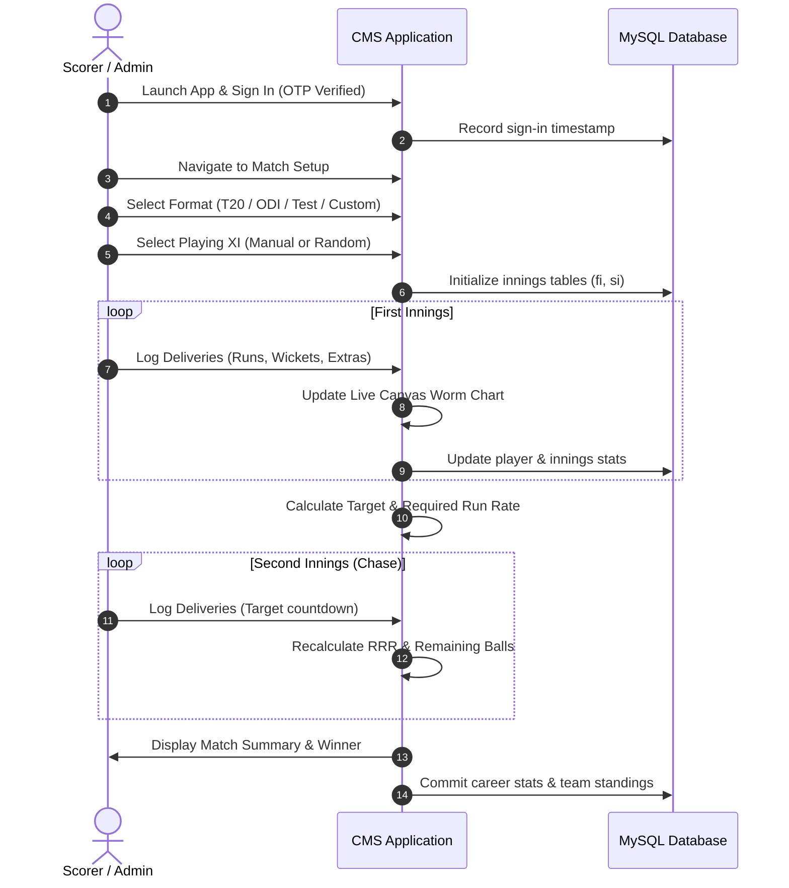
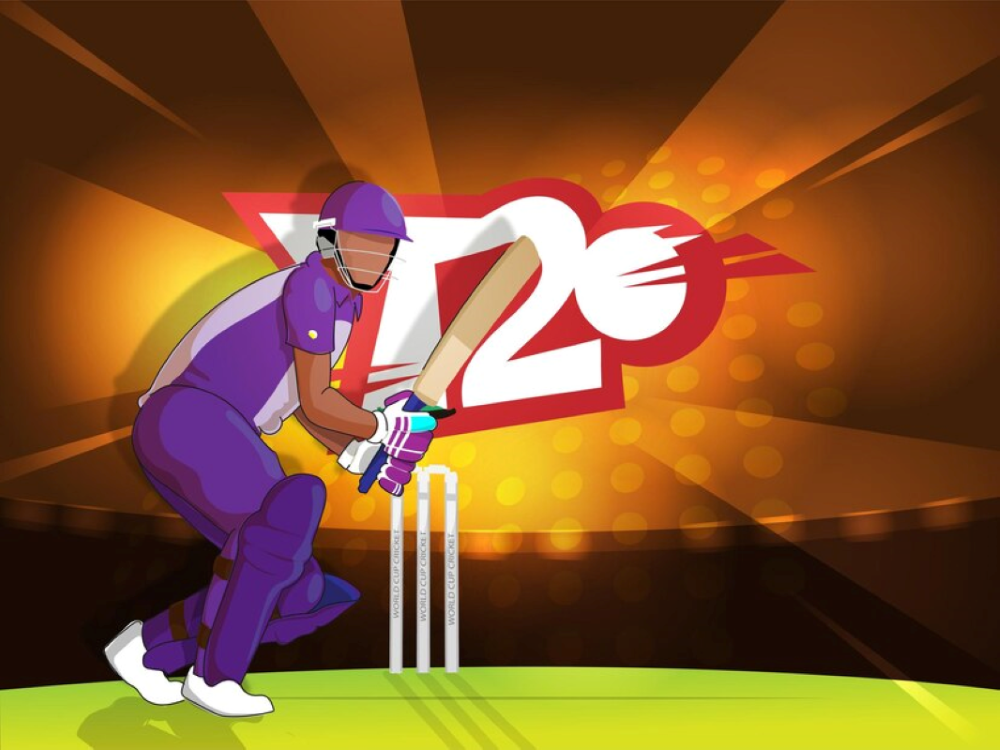

# 🏏 Cricket Scoreboard Management System Using Python

<p align="center">
  
</p>

<p align="center">
  <strong>A modern, full-featured desktop application for cricket scoring, tournament record management, and live match analytics built with Python, CustomTkinter, and MySQL.</strong>
</p>

<p align="center">
  <a href="https://www.python.org/"></a>
  <a href="https://github.com/TomSchimansky/CustomTkinter"></a>
  <a href="https://www.mysql.com/"></a>
  <a href="https://matplotlib.org/"></a>
  <a href="https://pillow.readthedocs.io/"></a>
  <a href="LICENSE"></a>
</p>

---

## 📖 Table of Contents

- [Overview](#-overview)
- [Key Features](#-key-features)
- [System Architecture](#-system-architecture)
- [Database Schema](#-database-schema)
- [Project Structure](#-project-structure)
- [Prerequisites](#-prerequisites)
- [Installation & Setup](#-installation--setup)
- [Configuration](#-configuration)
- [User Guide & Workflows](#-user-guide--workflows)
- [Tech Stack](#-tech-stack)
- [Screenshots & UI Showcase](#-screenshots--ui-showcase)
- [Contributing](#-contributing)
- [License](#-license)
- [Author](#-author)

---

## 🌟 Overview

The **Cricket Scoreboard Management System (CMS)** is a desktop application engineered to digitize match scoring, player performance tracking, and team statistics. Built on a responsive **CustomTkinter** interface and backed by a relational **MySQL** schema, CMS handles real-time scoring rules—including extras (wides, no-balls, leg-byes), dismissal modes, strike rotation, innings transition, target tracking, and dynamic run-rate analytics.

Whether organizing local club tournaments, official standard matches (T20, ODI, Test), or custom non-standard matches, CMS provides an automated alternative to paper scorecards and fragmented spreadsheets.

---

## 🚀 Key Features

### 🔐 1. Authentication & Security
- **Dual-Mode Access**: User sign-in and account registration.
- **Two-Factor OTP Verification**: Integrated SMTP engine (`otp.py`) delivering 6-digit one-time passcodes via Gmail TLS for sign-ins and password resets.
- **Session Audit History**: Automatically records user sign-in and sign-out timestamps in the database for activity logging.

### 🏏 2. Comprehensive Match Scoring Engine
- **Standard Match Modes**: Built-in support for official formats—**T20** (20 overs), **ODI** (50 overs), and **Test** matches.
- **Custom / Non-Standard Match Modes**: Configure arbitrary ball counts, overs, and wicket limits for practice sessions and gully cricket.
- **Ball-by-Ball Logging**:
  - Regular runs (0, 1, 2, 3, 4, 6)
  - Dismissals (Bowled, Caught, Run Out, Stumped, etc.)
  - Extras handling: Wide balls, No-balls, Leg byes, Byes
- **Innings Transition & Target Setting**: Auto-computes target score, required run rate (RRR), current run rate (CRR), and balls remaining.
- **Match Outcome Resolution**: Determines win, loss, or tie results and commits aggregated outcomes to team and player tables.

### 👥 3. Team & Player Administration
- **Team Registry**: Add and track clubs and franchises across formats (T20, ODI, Test) with records for wins, losses, and ties.
- **Player Profiles**: Register players with jersey numbers and associated team affiliations.
- **Squad Selection**: Interactive squad picking prior to match start with manual pick and randomized selection options.
- **Career Statistics Tracking**: Automatically updates individual player tallies:
  - Runs scored & balls faced
  - Wickets taken
  - Milestone counters (50s and 100s)

### 📈 4. Real-Time Analytics & Visualization
- **Live Canvas Graphs**: Custom vector graph component (`ctk_graph.py`) rendering real-time run progression curves.
- **Matplotlib Integration**: Visual analytics for innings performance comparisons and worm charts.

---

## 🏗️ System Architecture

```mermaid
flowchart TD
    subgraph UI ["Client Layer (CustomTkinter GUI)"]
        A[Login / Sign Up Screen] -->|OTP Verification| B[Main Dashboard]
        B --> C[Player & Team Management]
        B --> D[Match Setup & Squad Picker]
        B --> E[Live Scoreboard Engine]
        B --> F[Statistical Analytics & Graphs]
    end

    subgraph Service ["Business Logic Layer"]
        G[Email OTP Service (smtplib / ssl)]
        H[Scoring Engine (Target, Chase, Extras)]
        I[Graph Engine (CTkGraph / Matplotlib)]
    end

    subgraph DB ["Data Persistence Layer (MySQL)"]
        J[(MySQL: cms database)]
        J --> K[accounts & loginhistory]
        J --> L[teams & players]
        J --> M[fi, si, first, second]
    end

    A --> G
    D --> H
    E --> H
    H --> I
    A -.->|Read / Write| K
    C -.->|CRUD Operations| L
    E -.->|Innings Updates| M
```

---

## 🗄️ Database Schema

The system automatically initializes the `cms` database and creates the necessary relational tables on first run:

```mermaid
erDiagram
    ACCOUNTS {
        varchar username PK
        varchar email
        varchar password
    }

    LOGINHISTORY {
        varchar username
        datetime signintime
        datetime signouttime
    }

    TEAMS {
        varchar name PK
        varchar FORMAT
        int winst20
        int winsodi
        int winstest
        int losst20
        int lossodi
        int losstest
        int tiet20
        int tieodi
        int tietest
    }

    PLAYERS {
        varchar name
        varchar jersey
        int runst20
        int runsodi
        int runstest
        int ballst20
        int ballsodi
        int ballstest
        int wicketst20
        int wicketsodi
        int wicketstest
        int 50st20
        int 100st20
        int 50sodi
        int 100sodi
        int 50stest
        int 100stest
        varchar team FK
    }

    FIRST_INNINGS {
        varchar name
        int runs
        int balls
        int 4s
        int 6s
        int wickets
        int status
    }

    SECOND_INNINGS {
        varchar name
        int runs
        int balls
        int 4s
        int 6s
        int wickets
        int status
    }

    ACCOUNTS ||--o{ LOGINHISTORY : logs
    TEAMS ||--o{ PLAYERS : rosters
```

### Table Descriptions

| Table | Purpose |
| :--- | :--- |
| `accounts` | User credentials (username, email, password) for authentication |
| `loginhistory` | Audit log of login and logout timestamps per user |
| `teams` | Team metadata and lifetime win/loss/tie records across T20, ODI, and Test |
| `players` | Detailed player statistics across all three formats |
| `fi` / `first` | Active first-innings scoring table (batsman runs, balls, boundaries, wickets) |
| `si` / `second` | Active second-innings chase scorecard |

---

## 📁 Project Structure

```
cms 2/
├── CMS_logo.ico          # Application icon
├── login.png             # Login interface background art
├── cricket.png           # Cricket banner graphic
├── T20.png               # Match format graphic
├── hyy.png               # User account profile banner
├── L1.png - L6.png       # Navigation button graphics (left menu)
├── R1.png - R3.png       # Action button graphics (right menu)
├── ctk_graph.py          # Custom graph widget for canvas-rendered charts
├── otp.py                # Email OTP generation and SMTP dispatch
├── main.py               # Main application entry point and GUI logic
├── requirements.txt      # Python dependencies
├── .gitignore            # Git exclusion rules
├── LICENSE               # MIT License
└── README.md             # Project documentation
```

---

## ⚙️ Prerequisites

1. **Python 3.9 or higher**: [Download Python](https://www.python.org/downloads/)
2. **MySQL Server 8.0+**: [Download MySQL](https://dev.mysql.com/downloads/mysql/)
3. **Gmail Account (Optional for 2FA)**: An App Password generated from your Google Account security settings if utilizing automated OTP delivery.

---

## 🛠️ Installation & Setup

### 1. Clone the Repository

```bash
git clone https://github.com/TJeyesh/Cricket-Scoreboard-Management-System-Using-Python.git
cd Cricket-Scoreboard-Management-System-Using-Python
```

### 2. Create and Activate a Virtual Environment

**macOS / Linux:**
```bash
python3 -m venv venv
source venv/bin/activate
```

**Windows:**
```powershell
python -m venv venv
venv\Scripts\activate
```

### 3. Install Dependencies

```bash
pip install --upgrade pip
pip install -r requirements.txt
```

---

## 🔧 Configuration

### Database Configuration

Ensure your MySQL server is running. In [main.py](file:///Users/tjeyesh/Personal%20Folder/Work/Store/cms%202/main.py), configure your database credentials:

```python
mydb = mysql.connector.connect(
    host='localhost',
    user='root',         # Replace with your MySQL username
    passwd='your_password',  # Replace with your MySQL password
    auth_plugin='mysql_native_password',
    buffered=True
)
```

> **Note**: On the first run, the application will automatically create the `cms` database and initialize all required tables.

### Email OTP Configuration (Optional)

In [otp.py](file:///Users/tjeyesh/Personal%20Folder/Work/Store/cms%202/otp.py), configure the sender email address and Google App Password:

```python
smtp_port = 587
smtp_server = "smtp.gmail.com"
passwd = "your_google_app_password"
email_from = "your_email@gmail.com"
```

---

## 🎮 User Guide & Workflows

### 1. Launching the Application

Run the application:
```bash
python main.py
```

### 2. Match Scoring Lifecycle



---

## 💻 Tech Stack

| Technology | Purpose |
| :--- | :--- |
| **Python** | Core application programming language |
| **CustomTkinter** | Modern, dark/light theme desktop GUI framework |
| **MySQL / mysql-connector** | Relational data persistence and career records |
| **Pillow (PIL)** | Image asset handling and high-DPI scaling |
| **Matplotlib** | Statistical charts and analytics rendering |
| **smtplib & ssl** | Secure TLS email transmission for OTP authentication |

---

## 📸 Screenshots & UI Showcase

| Login & Authentication | Dashboard & Navigation |
| :---: | :---: |
|  |  |

| Format Selection | Match Management |
| :---: | :---: |
|  |  |

---

## 🤝 Contributing

Contributions are welcome! To contribute:

1. **Fork** the repository.
2. **Create a Feature Branch**:
   ```bash
   git checkout -b feature/AmazingFeature
   ```
3. **Commit Your Changes**:
   ```bash
   git commit -m "Add some AmazingFeature"
   ```
4. **Push to the Branch**:
   ```bash
   git push origin feature/AmazingFeature
   ```
5. **Open a Pull Request**.

---

## 📄 License

Distributed under the **MIT License**. See [`LICENSE`](LICENSE) for details.

---

## 👤 Author

**T. Jeyesh**
- GitHub: [@TJeyesh](https://github.com/TJeyesh)
- Project: [Cricket Scoreboard Management System Using Python](https://github.com/TJeyesh/Cricket-Scoreboard-Management-System-Using-Python)
